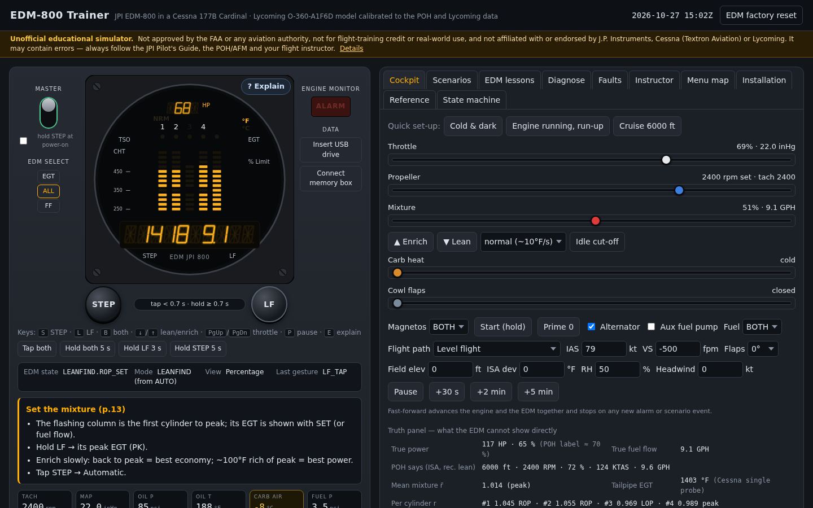
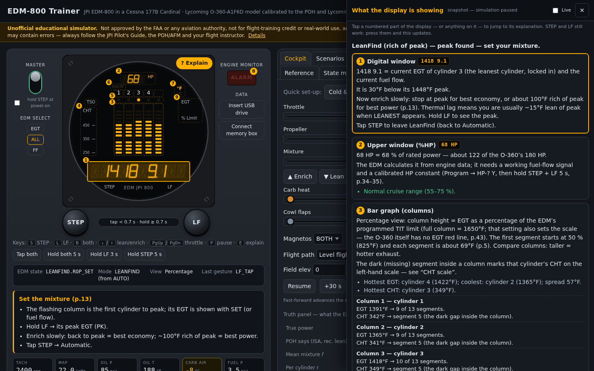
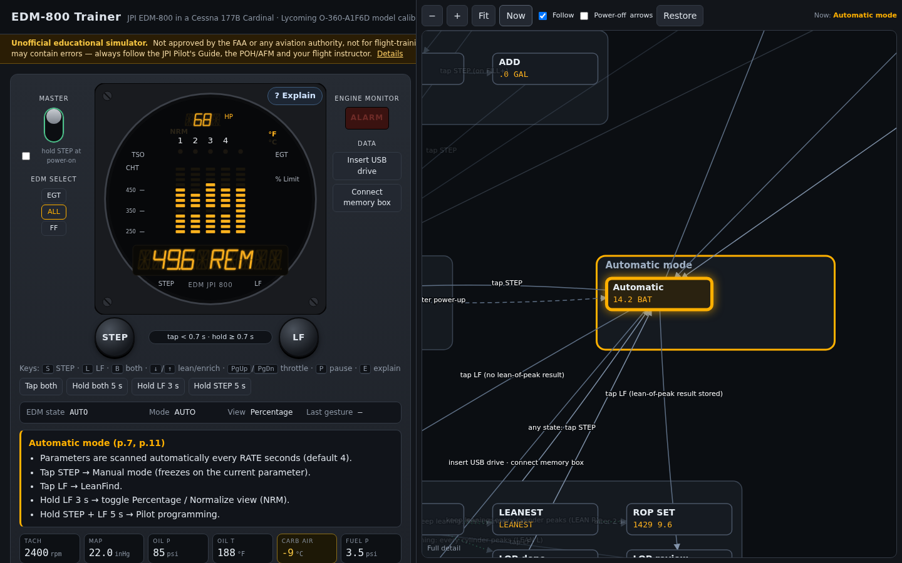
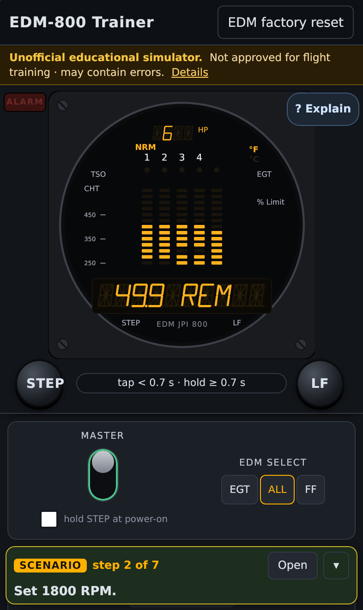

# EDM-800 Trainer — Cessna 177B Cardinal / Lycoming O-360

> [!WARNING]
> **Unofficial educational simulator — not approved for flight training.**
> - This is a personal project for familiarisation and study. It is not approved, certified or endorsed by the FAA or
>   any other aviation authority, and using it does not count toward any training, currency, rating or certificate.
> - It is not affiliated with, endorsed by or supported by J.P. Instruments, Textron Aviation (Cessna) or Lycoming.
>   Product names are used only to describe what is simulated.
> - The instrument behaviour and the engine model are approximations and may be wrong. Don't use it to make decisions
>   about a real aircraft or flight. Always follow the J.P. Instruments Pilot's Guide, the aircraft's POH/AFM, the
>   engine manufacturer's guidance and your flight instructor.
> - Provided "as is", without warranty of any kind (see `LICENSE`).

**▶ Try it in your browser: https://zabirauf.github.io/edm800-sim/** — works on desktop, tablets and phones.



| Explain what the display shows | The whole state machine, live | Scenarios on a phone |
|---|---|---|
|  |  |  |

A simulator for learning the **JPI EDM-800** engine monitor, built from the JPI Pilot's Guide (EDM-700/800/711,
Rev W). It is set up as installed in a **Cessna 177B Cardinal with a Lycoming O-360-A1F6D (180 HP, carbureted,
constant-speed prop)**. It has three parts:

1. an executable state machine of the instrument (every mode, menu and alarm) with an independent test suite;
2. a physics-based engine, airframe and systems model calibrated to the POH, the Lycoming operator's manual and
   measured fuel flows (`docs/08-CALIBRATION-REPORT.md`);
3. a web cockpit that connects the two, with scenarios, lessons and an instructor panel.

## Open the simulator

Use the hosted copy at https://zabirauf.github.io/edm800-sim/. GitHub Pages republishes it on every push to `main`
(`.github/workflows/pages.yml`).

Or use `dist/edm800-simulator.html`: it's self-contained, so you can open it in any modern browser with no server.
Rebuild after changes with `npm run build`. On the first visit the simulator shows the disclaimer above and asks you
to acknowledge it. A short version stays in a banner at the top, and "Details" reopens the full text. Demo recordings: `dist/demo-desktop.gif` (full tour), `dist/demo-iphone.gif`,
`dist/demo-fold.gif` and `dist/demo-statemap.gif` (the state-machine view).

It works on phones, tablets and foldables:
- **Phones (portrait, < 720 px wide):** one column, with the instrument face and STEP/LF pinned to the top while you
  scroll to the levers. The alarm light is pinned beside the face.
- **Tablets, foldable inner screens, landscape phones and desktop:** two columns, with the instrument column kept in
  view.
- **Touch:** text fields are 16 px so iOS doesn't zoom in on focus, tap targets are at least 36 px, and hold buttons
  (STEP, LF, Start, Lean/Enrich) don't trigger the long-press menu.

**EDM buttons:** click or touch-and-hold **STEP** and **LF** (two fingers or two pointers for "both"), or use the
keyboard: `S` = STEP, `L` = LF, `B` = both, `↓`/`↑` = lean/enrich (hold), `PgUp`/`PgDn` = throttle, `P` = pause. Gesture helper buttons ("Tap both", "Hold both 5 s", …) are there for
single-pointer devices. The hold meter under the face shows how long the buttons are held (tap < 0.7 s; LF 3 s =
view toggle; 5 s for STEP and both-button holds).

**Explain (`? Explain` on the instrument, or the `E` key):** explains everything the display is showing at that
moment.
- **Snapshot:** the simulation pauses and every part of the face gets a numbered marker: digital window, %HP window,
  bar graph, CHT scale, dot, NRM, °F/°C, ALARM light and printed legends.
- **The panel says, for this exact state:**
  - what each number is, with its units;
  - what each column's height and CHT segment mean, cylinder by cylinder;
  - which cylinder the dot points to and why;
  - which alarm is active, its limit and how to silence it;
  - what STEP and LF do right now;
  - Cardinal/Lycoming context, e.g. "CHT 452°F is above Lycoming's 435°F high-power cruise guidance".
- **Behind the instrument:** what the simulator knows but a real EDM can't show — true power, which cylinder is really
  leanest, carb ice, misfire.
- **Interaction:** tap any part of the face to jump to its explanation, or tap an explanation to highlight that part.
  STEP and LF still work while the panel is open, and it updates as the display changes.
- **Live:** check "Live" to keep flying with the panel open; it refreshes every second.
- **Layout:** a drawer beside the instrument on wide screens, a sheet under the pinned face on phones.
- **Source:** the text is generated by `web/explain.js` and checked by `test/explain.test.mjs` against what the
  instrument is actually displaying.

**Step card:** while a scenario or EDM lesson is running, its current step floats on every other tab, so you can work
in Cockpit, Faults or Reference without switching back. The card shows "step 3 of 7", the step text, the latest
scenario event and any watch-out warning.
- It flashes green when a step is completed, and **Open** jumps back to the full scenario.
- **▾** collapses it to one line showing just the step.
- On wide screens it sits at the top of the controls column; on phones it's a compact bar at the bottom, leaving the
  band between the pinned instrument and the bar for the controls.

**State machine (dev view)** is the last tab; http://…/edm800-simulator.html#statemachine opens it full-size.
It shows the whole EDM state machine as a zoomable map, with the live state highlighted as you use the instrument.
- **How the map is made:** it isn't hand-drawn. `src/edm/explore.js` drives the real state machine from power-off and,
  from every reachable state, tries every input:
  - taps, holds and both-button chords;
  - timers;
  - power, USB and memory box;
  - in LeanFind, leaning the mixture.

  It finds 76 states and records where each input leads, takes about 1.5 s, and runs in slices so the page never
  freezes. It is re-run when the installation changes.
- **Zoom levels:**
  - zoomed out: the groups (power-up, Manual/Automatic, LeanFind, programming…) and the arrows between them;
  - in: every state with its sample display;
  - further: every transition label.
- **Arrows:**
  - solid = button, dashed = timer, dotted = engine/leaning;
  - exits shared by a whole group are drawn once from the group's border;
  - branches say what decides them, e.g. "tap STEP (on FUEL? Y)", "remove USB drive (entered from Automatic)";
  - timers show the code's real durations.
- **Live:** the current state glows and the transition just taken flashes; **Follow** keeps it in view.
- **Details:** select a state to see what it displays, its help text, every way in and out, and the exact input
  sequence to reach it from where the instrument is now. **Show route** highlights that sequence on the map.
- **Performance:** pan and zoom (drag, wheel, trackpad or two-finger pinch) change one transform, and the levels of
  detail are CSS classes, so the drawing is never rebuilt. It runs at 60 fps.
- **Tests:** `test/statemap.test.mjs` checks that:
  - the map has every state of this installation and no others;
  - the documented statechart transitions and timer values are all present;
  - a 3000-step random walk on a real EDM never reaches a state the map lacks;
  - routes from the map, replayed on a real EDM, arrive where they say.

**Tabs**

| Tab | What it's for |
|---|---|
| Cockpit | Throttle, prop, mixture, carb heat and cowl flaps; magnetos, Start (hold), Prime, master and alternator, aux pump, fuel selector; flight mode, IAS, vertical speed and flaps; OAT, humidity and field elevation. Also quick set-ups (cold aircraft, run-up, cruise …), pause and fast-forward (stops on a new alarm), and an optional "truth" panel showing what the engine is actually doing. |
| Scenarios | 26 situations, each with a brief, live watch-outs and a debrief: cold start, run-up, fouled plug, take-off and climb, high density altitude, hot climb, leaning by EGT vs POH, lean-of-peak attempt, carb ice and re-leaning after carb heat, shock cooling, descent and go-around, induction leak, burned valve, detonation (misfuel), pre-ignition, magneto failure, over-voltage, oil cooler, tank run dry, failed probe, blocked filter, cold weather … |
| EDM lessons | Guided exercises on the instrument itself (modes, LeanFind, fuel, alarms, program menus) with automatic step checks. |
| Diagnose | Mystery-fault trainer based on the Pilot's Guide engine diagnosis chart. |
| Faults | Inject engine faults, probe failures and GPS states by hand. |
| Instructor | Every assumed model value with its source tag and range as a slider; engine "personality" (which cylinder runs lean); calibration figures. |
| Menu map | Where you are in the instrument's menus. |
| Installation | EDM options and model (700/800/711 primary). |
| Reference | Quick reference card plus Cardinal limits, run-up, leaning, carb-ice and descent cards. |

## Documents

| File | Contents |
|---|---|
| `docs/02-SPEC.md` | Behavioral specification (rule IDs, interpretation and conflict registers) — rev3.2 |
| `docs/03-SPEC-REVIEW.md` | Independent review of the spec against the manual (all findings dispositioned in spec §22) |
| `docs/04-STATE-MACHINE.md` | State machine design, API, statecharts |
| `docs/05-VALIDATION-REPORT.md` | Independent validation of the state machine against the spec, plus test coverage |
| `docs/06-ENGINE-SIM-PLAN.md` | Engine simulation plan v2; §11 lists where the implementation departs from it |
| `docs/07-ENGINE-PLAN-CRITIQUE.md` | Independent critique of the engine plan (all findings dispositioned in plan §10) |
| `docs/08-CALIBRATION-REPORT.md` | Fitted parameters, agreement with published data, known source conflicts |
| `docs/09-TLA-EVALUATION.md` | TLA+ formal model of the mode/alarm logic, conformance check of the implementation, findings |
| `docs/research/` | Sourced engine and airframe data used for calibration |

## Code

```
src/edm/      instrument state machine (pure JS, no DOM); explore.js discovers its state graph
src/sim/      O-360 engine, airframe, flight, fuel/electrical systems, sensors, scenarios, pilot helpers
  data/       POH cruise tables and digitized Lycoming / FOCA data
  fitted.js   generated by tools/fit.mjs — do not edit
web/          simulator UI (SVG instrument face, cockpit, scenarios, lessons, reference)
test/         node:test suites (EDM in test/, engine model in test/sim/)
tools/        fit.mjs (calibration), report.mjs (calibration figures), replay.mjs (EDM log replay), extract-poh.mjs
test/visual/  Playwright visual + responsive tests (playwright.config.mjs)
scripts/      build (single-file bundle), record-demo.mjs (GIFs), webkit-deps.sh, tla-check.sh
spec/tla/     TLA+ formal model (EDMCore.tla), TLC models (MC_*), generated implementation graphs (ImplGraph_*)
```

| Command | Does |
|---|---|
| `npm test` | All unit tests (EDM, engine model, Explain, state-machine map — ≈600, ≈12 s) |
| `npm run test:edm` / `npm run test:sim` | One of the two suites |
| `npm run fit` | Re-fit the engine/airframe constants and regenerate `src/sim/fitted.js` |
| `npm run build` | Bundle `dist/edm800-simulator.html` |
| `npm run test:visual` | Build, then run the visual/responsive tests on 9 device profiles (below) |
| `npm run test:visual:update` | Re-record the reference screenshots after an intended UI change |
| `npm run test:visual:report` | Open the HTML report (side-by-side and slider diffs of any mismatch) |
| `npm run demo:gif` | Record `dist/demo-{statemap,desktop,iphone,fold}.gif` (needs ffmpeg) |
| `npm run verify` | Everything before a release: unit tests, the TLA+ formal check, then the visual tests (≈10 min) |
| `npm run tla` | Formal check: explore the implementation, then TLC model-checks `spec/tla/EDMCore.tla` and judges the implementation against it (needs Java 11+ and `tla2tools.jar`) |
| `node tools/tla-mutants.mjs` | Plant ten bugs one at a time and confirm the TLA+ check catches each |
| `node tools/report.mjs` | Print the calibration figures as JSON |
| `node tools/replay.mjs flight.csv` | Drive the model with a real EDM data export (RPM/MAP/FF, optionally ALT/IAS/OAT) and compare EGT/CHT/oil |

## Visual tests

`test/visual/` (Playwright). Apple devices run in **WebKit**, Safari's engine; Android and desktop run in Chromium.

| Device profile | Viewport (CSS px) | Engine |
|---|---|---|
| desktop | 1440×900 | Chromium |
| iphone-se | 320×568 | WebKit |
| iphone-15 | 393×659 | WebKit |
| iphone-15-pro-max-landscape | 814×380 | WebKit |
| pixel-7 | 412×839 | Chromium |
| ipad-mini | 768×1024 | WebKit |
| ipad-pro-11-landscape | 1194×834 | WebKit |
| iphone-fold-inner | 904×576 | WebKit |
| iphone-fold-inner-portrait | 640×840 | WebKit |

The two fold profiles are an assumption. No "iPhone Duo" exists; they use the leaked spec for the foldable iPhone's
inner screen (7.76", 2713×1920, about 904×640 pt at 3×, minus Safari's toolbars).

- **`layout.spec.mjs`, on every device:**
  - the face is drawn before power-on;
  - no tab scrolls the page sideways;
  - the face stays on screen while the mixture lever is in view;
  - STEP and LF are at least 48 px and nothing covers them;
  - touch-screen rules (16 px fields, 36 px buttons, no long-press callout);
  - a finger tap on LF arms LeanFind, and holding Lean reaches `LEANEST`;
  - on Pixel only (it needs Chromium's raw touch input): a real two-finger, 5-second hold on STEP and LF opens pilot
    programming.
- **`screens.spec.mjs`:** screenshot comparisons, stored in `test/visual/__screenshots__/<device>/`.
  - Every device: cold and dark, self-test, cruise, cruise with levers, LeanFind `LEANEST`, program menu, over-voltage
    alarm.
  - Desktop, iPhone 15 and the fold inner screen: each tab.
- **Determinism:** runs use Playwright's fake clock and a seeded `Math.random`, so each screenshot is identical
  between runs. They are recorded on this machine, so another OS or font set needs `npm run test:visual:update` first.
- **WebKit on Ubuntu without root:** `npm run webkit:deps` downloads the five missing libraries into
  `~/.cache/pw-webkit-deps` (`apt-get download`, no sudo); the config picks them up automatically. On macOS, or with
  sudo (`npx playwright install-deps webkit`), this isn't needed.
- **Traces:** Playwright records a trace only on a retry, because trace recording occasionally crashed Linux WebKit
  pages.
- **Playwright version:** `@playwright/test` is pinned to 1.52.0 because its browsers were already installed. npm
  audit flags versions below 1.55.1 (GHSA-7mvr-c777-76hp): `npx playwright install` doesn't verify the download
  server's certificate. Upgrade before downloading browsers with it.

## Formal check (TLA+)

`spec/tla/EDMCore.tla` states the mode and alarm rules of the spec as a TLA+ state machine. It covers:
- power-up, Manual/Automatic, LeanFind and fuel fill;
- the programming main menu and USB download;
- alarm display, priority, silencing and expiry, the alarm light, and the OFF/SNAP overlays.

`npm run tla`:
- explores the real implementation at the same level of abstraction (`tools/tla-conformance.mjs`);
- has TLC check that both sides reach the same states and take the same steps, that the spec's invariants hold, and
  that the pilot can always get back to Manual or Automatic.

Both models currently agree exactly (6 196 and 18 884 states). The first run found a real bug: STEP could silence an
alarm hidden under the OFF/SNAP confirmation. It is fixed, ALM-6 is clarified (rev3.2), and there are regression
tests. Details and lessons are in `docs/09-TLA-EVALUATION.md`.

## Accuracy and limits

Power, fuel flow, manifold pressure, airspeed and climb rate are fitted to published data. On hold-out POH tables the
model is within ≈0.9 %BHP, 0.2 GPH and 1.4 kt RMS. EGT and CHT levels, cooling time constants and which cylinder runs
leanest are **typical values, not measurements from your aircraft**. They are marked as assumed, have ranges, and the
lessons are tested at both ends of each range. An EDM data export from a Cardinal (`tools/replay.mjs`) is the best way
to tighten them.

## Source material

The behaviour comes from J.P. Instruments' *EDM-700/800/711 Pilot's Guide*, Rev W. The Pilot's Guide is not included
in this repository because it is JPI's copyrighted document; get it from J.P. Instruments. The docs refer to a local
copy at `source/PG-EDM-800-Rev-W.pdf` and to a local structured extract of it, `docs/01-MANUAL-EXTRACT.md`. Neither is
in the repository; the spec (`docs/02-SPEC.md`) cites the manual's page numbers for every rule instead. Engine and airframe data come from the Cessna 177B POH and Lycoming publications,
as cited in `docs/research/`.

Training aid only — not a substitute for the Pilot's Guide, the POH/AFM, or flight instruction.

## License

MIT — see `LICENSE`. This covers the code and documentation in this repository, not the J.P. Instruments, Cessna or
Lycoming publications it refers to.
