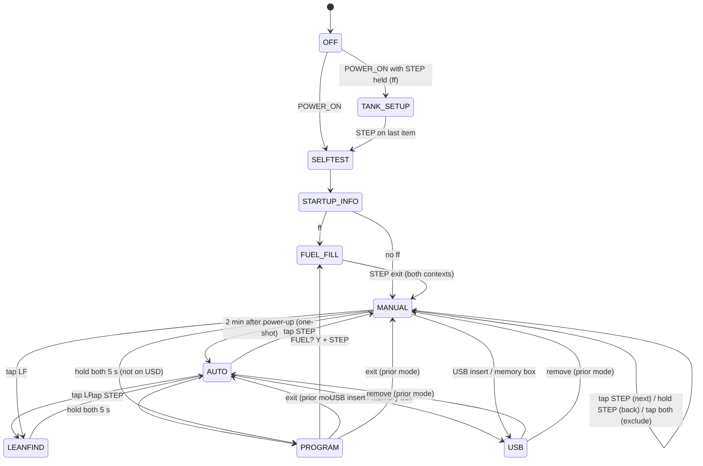
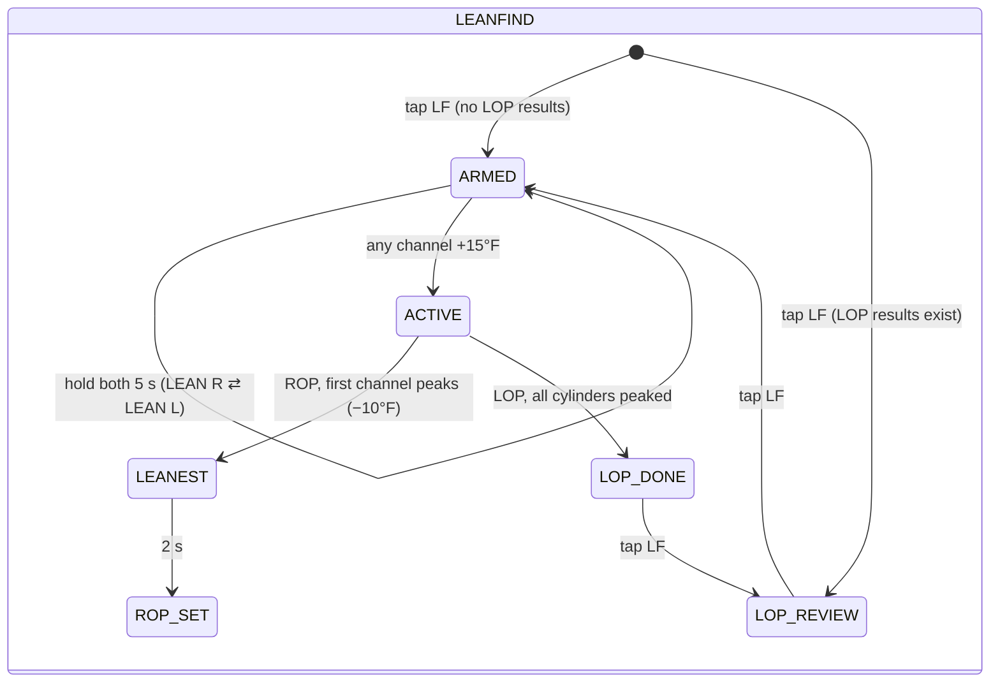
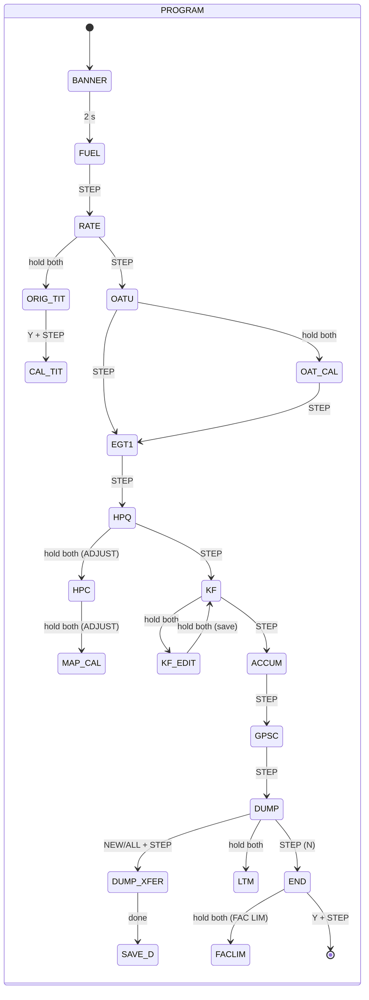

# EDM-800 State Machine — Design and API

Implementation: `src/edm/` (pure JavaScript ES modules, no dependencies, no DOM). Behavior is defined by
`docs/02-SPEC.md` (rev2); rule IDs from the spec are cited in code comments.

```
src/edm/constants.js   timing constants (§16), factory limits, scan order, unit tables
src/edm/gestures.js    GestureRecognizer: raw PRESS/RELEASE + time → semantic gestures (§4)
src/edm/settings.js    defaultSettings(config), factoryLimits(unit, busVolts, primary711)
src/edm/format.js      display number formatting (§7.2)
src/edm/machine.js     class EDM — the instrument state machine
src/sim/engine.js      engine/sensor model used by the web simulator (not instrument logic)
```

## Driving the machine

```js
import { EDM, defaultSensors } from './src/edm/machine.js';

const edm = new EDM({ config: { model: 800, cylinders: 6, ff: true, tit: 1, oil: true }, clockMs: Date.UTC(2026, 9, 27, 14, 0) });
edm.send({ type: 'SENSORS', data: { egt: [1340, ...], cht: [...], tit: [1450, 0], oil: 185, bat: 14.1, rpm: 2400, map: 23.1, ffGph: 12.5, pctHp: 65 } });
edm.send({ type: 'POWER_ON' });
edm.send({ type: 'TICK', ms: 12000 });            // time only advances via TICK
edm.send({ type: 'PRESS', button: 'STEP' });       // 'STEP' | 'LF'
edm.send({ type: 'TICK', ms: 100 });
edm.send({ type: 'RELEASE', button: 'STEP' });     // → STEP_TAP gesture
edm.getState();   // { state, path, mode, item, view, alarm, excluded, leanfind?, program?, lopResults }
edm.getDisplay(); // { power, allOn, digital:{text,blink,flashIndex}, upper:{text}, view, viewStyle, unit,
                  //   columns:[{id,label,segs,chtSeg,oilSeg,inverted,flash,topFlash,oilFlash,missing,labelFlash}],
                  //   dot:{index,blink}, alarmLight, lamps711, brightness }
edm.settings;     // non-volatile settings object (rate, limits, rem, usd, kf, ...) — readable for assertions
```

Events: `TICK{ms}`, `PRESS{button}`, `RELEASE{button}`, `POWER_ON`, `POWER_OFF`, `SENSORS{data}` (merged into the
current sensor frame), `SELECT_SWITCH{position:'T'|'A'|'F'}`, `USB_INSERT`, `USB_REMOVE`, `MEMBOX_CONNECT`,
`MEMBOX_DISCONNECT`, `AMBIENT{level}`.

Time: `TICK{ms}` advances in 50 ms sub-steps; gesture thresholds and timers fire at the first sub-step at or after
their deadline, so assertions should allow one 50 ms sub-step of slack. Gestures are recognized from raw button
events; e.g. a tap = PRESS, TICK(<700 ms), RELEASE. A "both" chord = PRESS STEP, PRESS LF (second press within
700 ms of the first, before the first's hold starts), hold, then release both.

Sensor frame fields (`defaultSensors()` gives an engine-off frame): `egt[6]`, `cht[6]`, `tit[2]`, `oil`, `oat`, `iat`,
`cdt`, `crb` (°F), `bat` (V), `rpm`, `map` (inHg), `ffGph` (true gal/h), `ffSignal` (bool), `pctHp` (true % power),
`gps {status: off|nocom|nosig|nowpt|ok, offCourse, gs (kt), dist (nm)}`, `failed[]` and `calErr[]` channel ids
(`EGT1`..`EGT6`, `CHT1`..`CHT6`, `OIL`, `TIT1`, `TIT2`, `OAT`, `IAT`, `CDT`, `CRB`).

## State paths (`getState().path`)

| Path | Meaning |
|---|---|
| `OFF` | powered off |
| `TANK_SETUP.MAIN` / `.AUXQ` / `.AUX` | power-on with STEP held (ff) |
| `SELFTEST.SEGMENTS` / `.COLUMNS` / `.PROBES` | self-test |
| `STARTUP_INFO.DATE` / `.TIME` / `.FULL` / `.ID` | long-term memory info |
| `FUEL_FILL.BANNER` / `.SEL` / `.ADD` | start-up or in-flight fuel entry |
| `AUTO`, `MANUAL` | scanning modes (`getState().item` = scan item id) |
| `LEANFIND.ARMED` / `.ACTIVE` / `.LEANEST` / `.ROP_SET` / `.LOP_DONE` / `.LOP_REVIEW` | LeanFind |
| `PROGRAM.BANNER`, `PROGRAM.ITEM.<FUEL|RATE|OATU|EGT1|HPQ|KF|ACCUM|GPSC|DUMP|END>` | pilot program main list |
| `PROGRAM.OAT_CAL`, `.ADJUST`, `.HPC`, `.MAP_CAL`, `.KF_EDIT`, `.ORIG_TIT`, `.CAL_TIT`, `.DUMP_XFER`, `.SAVE_D` | program sub-screens |
| `PROGRAM.LTM.<TIME|MNTH|DAY|YEAR|HOUR|MIN|ID|END>`, `PROGRAM.LTM_ID_EDIT` | long-term memory setup |
| `PROGRAM.FACLIM_BANNER`, `PROGRAM.FACLIM.<FAC|ENG|HBAT|LBAT|DIF|HCHT|CLD|TIT|HOIL|LOIL|MAP|FUNIT|MAIN|AUXQ|AUX|MIN|REMLIM|CARB|RECRD|CYL|RHP|EC|END>`, `PROGRAM.EC_EDIT` | alarm limits list |
| `USB.MENU` / `.XFER` / `.DONE` | USB port / memory box download |

Scan item ids: `BAT OAT IAT CDT CRB DIF RPMMAP REM GPSMSG REQ RES MPG HM GPH USD EGT1..EGT6 CHTHI TIT1 TIT2 OIL CLD`.
Alarm ids: `CHT OILH TIT OILL CLD DIF BATH BATL MAP LOFUEL LOTIME`.

## Top-level statechart






(Items hidden by the select switch / options are skipped; see spec §12.)

## Layering

1. **GestureRecognizer** converts raw button edges + time into `STEP_TAP`, `LF_TAP`, `BOTH_TAP`, `*_HOLD_START`,
   `*_HOLD_REPEAT`, `LF_HOLD_3S`, `STEP_HOLD_5S`, `BOTH_HOLD_5S`, `*_RELEASE_HOLD`.
2. **Dispatch** routes STEP gestures to the alarm acknowledger when an alarm was displayed at STEP press (ALM-6),
   otherwise to the current top-level state handler.
3. **Update** (every 50 ms sub-step): derived values, fuel integration, CHT-rate history, LTM recording, timers
   (banners, self-test sequence, automatic scan dwell, 2-minute auto switch), LeanFind detection, alarm evaluation.
4. **getDisplay** renders the current state into the display model (digital text, bar-graph columns, dot, upper
   window, indicators, alarm light, 711 lamps). Display is a pure function of state + current sensors.

## Discovered state graph (`src/edm/explore.js`)

The statecharts above are hand-written summaries. The complete graph is discovered from the implementation itself:
- **Search:** `exploreStateMachine({config})` starts at `OFF` with a running-engine sensor frame and searches
  breadth-first. At each state it clones the machine and applies every input: tap/hold STEP and LF, holds of 3 s and
  5 s, STEP+LF tap and 5 s hold, timers, power on/off (with STEP held), USB/memory box and, in LeanFind, EGT rises and
  peaks.
- **Timers versus buttons:** an input that leads where simply waiting the same time would lead is not counted as a
  button transition.
- **State identity:** states are told apart by path, by the display text with digits masked, and by hidden context
  (LeanFind method, the mode to return to, stored lean-of-peak results, the `ADJUST` banner's next screen, `ctx` with
  numbers masked). Branches that depend on that context are therefore found and labelled.
- **Timer durations** are measured from the moment the state was entered.
- **Routes:** exact transitions between these context-keyed variants are kept too, so routes can be planned and
  replayed (`routeBetween` in `web/statemap.js`, `applyAction` here).
- **Size:** for the Cardinal installation it finds 76 states and 193 transitions in ≈1.3 s.
- **Tests:** `test/statemap.test.mjs` checks the result against this document and the spec, against a random walk on a
  real EDM, and by replaying routes.
- **Where it appears:** the "State machine" tab of the simulator draws it (`web/statemap.js`, `web/statemap-ui.js`).
